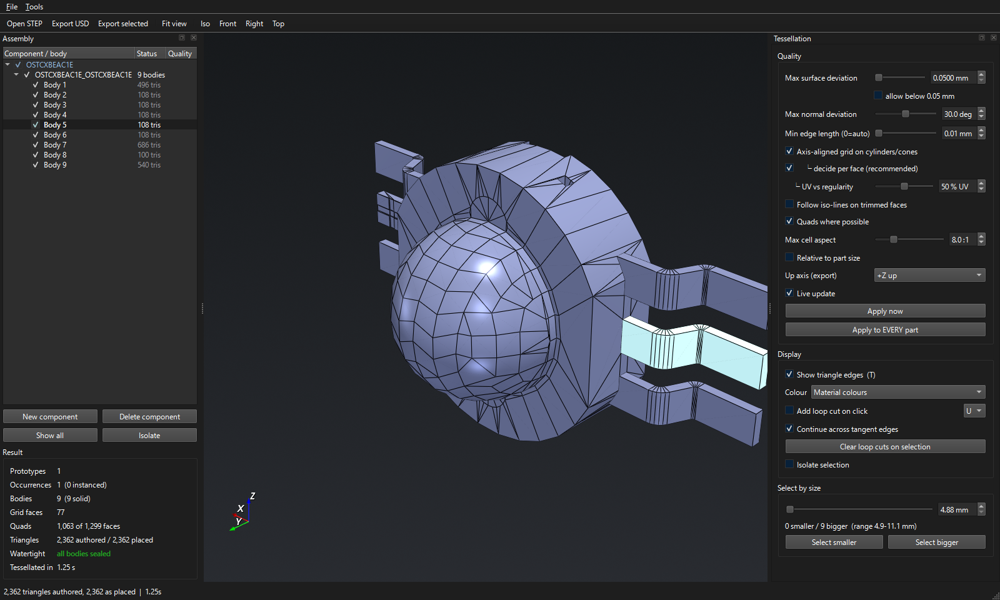
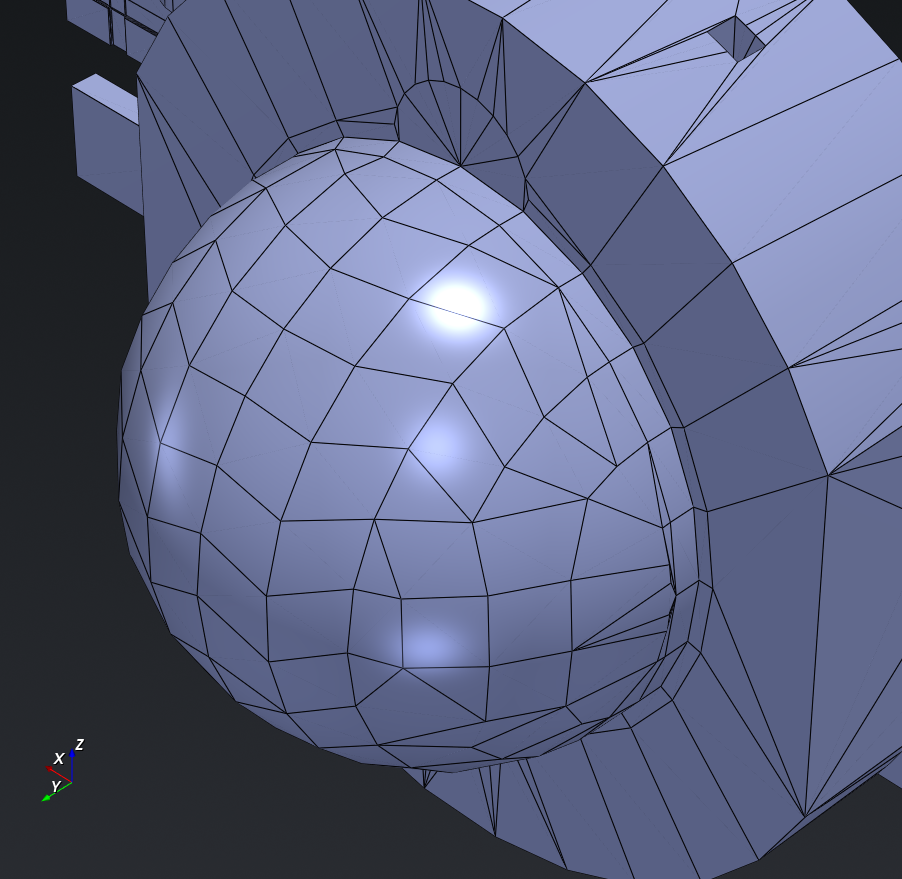
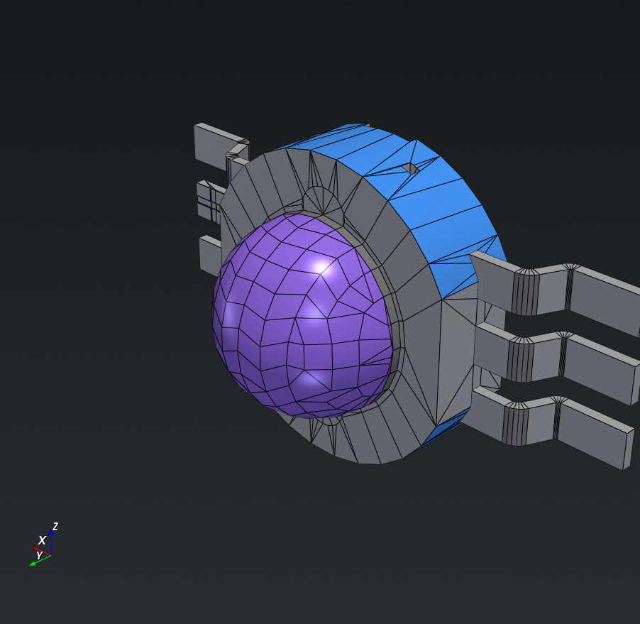
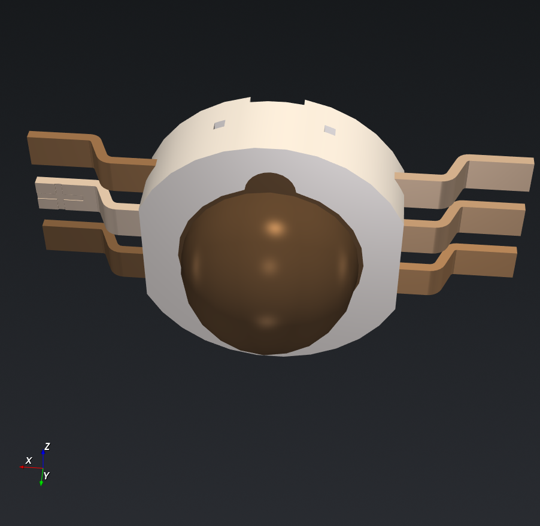

# CAD2Mesh — STEP to USD for Blender

A desktop tool that turns STEP files into clean, **watertight** USD meshes for
Blender. It keeps the assembly hierarchy, instancing and materials, and shows
a live 3D preview so you can judge the tessellation by eye before exporting.



It exists because the usual route, exporting from Fusion 360, gives no control
over tessellation and unwelds the mesh at every material boundary and sharp
edge. Here:

- **A closed solid always exports as a closed mesh.** Every body is checked
  for holes, non-manifold edges and winding errors, and the result panel says
  so plainly ("all bodies sealed") rather than leaving you to find out in
  Blender.
- **Sharp edges stay sharp without splitting the mesh.** Normals are written
  per face corner, so a real CAD edge is sharp and a fillet is smooth, while
  the mesh stays one welded piece. No creases are written.
- **The mesh follows the surface.** Cylinders, cones, fillets and spheres are
  rebuilt as grids that follow their own UV lines, with quads wherever
  possible, instead of a fan of long thin triangles.



## Features

**Tessellation you control, per part.** Max surface deviation, max normal
deviation, and minimum edge length, set globally or for just the selected
parts. Quality presets can be saved and reused, and the preview re-meshes live
as you drag.

**See what you are meshing.** Colour the model by material, by component, by
part (instances), by tessellation quality, or by surface type. The surface-type
view shows which faces are planes, cylinders, cones, tori, spheres or
free-form NURBS:

| By surface type | By component |
|---|---|
|  |  |

**Fix things in place.**
- **Loop cuts:** click a surface to add a cut along its U or V line. The cut
  continues across tangent faces until it meets a hard edge, so a full ring is
  one click. Shift snaps to edge tangents and corners, right-click removes a
  cut, and Ctrl+Z undoes.
- **Cap open shells:** fill the flat holes in a shell that was never a closed
  solid.
- **Step-through debugger:** reveals a body one face at a time and shows which
  meshing path each face took.

**Export what you need.**
- USD in **metres**, so everything imports into Blender at scale 1 and its
  real size.
- The assembly's own top component is the top object; no extra wrapper.
- Choice of up axis (±X, ±Y, ±Z).
- **Export selected** (Ctrl+Shift+S) writes only the chosen parts, at their
  real positions under their real parent components.
- Several materials on one part become material slots on one welded mesh.

**Blender-style keys.** H / Alt+H hide and show, Z isolates, `.` frames the
selection, T toggles the wireframe, Esc stops a long tessellation run.

## Install

Windows, Python **3.12** (the OCCT bindings do not support 3.14 yet).

```bash
py -3.12 -m venv .venv
.venv\Scripts\python.exe -m pip install -r requirements.txt
```

## Run

```bash
run_gui.bat                                          # double-click, no console
.venv\Scripts\python.exe run_gui.py model.step       # open a file straight away
.venv\Scripts\python.exe -m stepusd.cli model.step   # headless conversion
```

Once the app is running, the **Tools** menu can add it to Explorer's
right-click **Open with** list for `.step` / `.stp` files, and create Start
menu and desktop shortcuts. Neither needs admin rights, and no `.exe` is
built.

## Importing into Blender

File → Import → Universal Scene Description, and pick the exported `.usda`.
The import comes in at scale 1, with custom split normals carrying the sharp
edges, and one welded mesh per body. Checked with Blender 4.5.

## Project layout

```
stepusd/
  reader.py      STEP → assembly tree, names, colours
  tessellate.py  the mesher: welding, UV-following grids, quads, repair
  writer.py      USD out: hierarchy, instancing, materials
  loadproc.py    STEP parsing in a subprocess, with a geometry cache
  parallel.py    multi-core tessellation
  cli.py         headless conversion
  gui/           the desktop app (PySide6 + VTK)
spikes/          regression tests and diagnostic scripts
docs/            README screenshots (regenerate with docs/make_screenshots.py)
```

Built on [Open CASCADE](https://dev.opencascade.org/) through
[cadquery-ocp](https://github.com/CadQuery/OCP), with
[OpenUSD](https://openusd.org/), [VTK](https://vtk.org/) and
[Qt for Python](https://doc.qt.io/qtforpython/).

Screenshots show a public LED model
(`OSTCXBEAC1E--3DModel-STEP-510211.STEP`).
